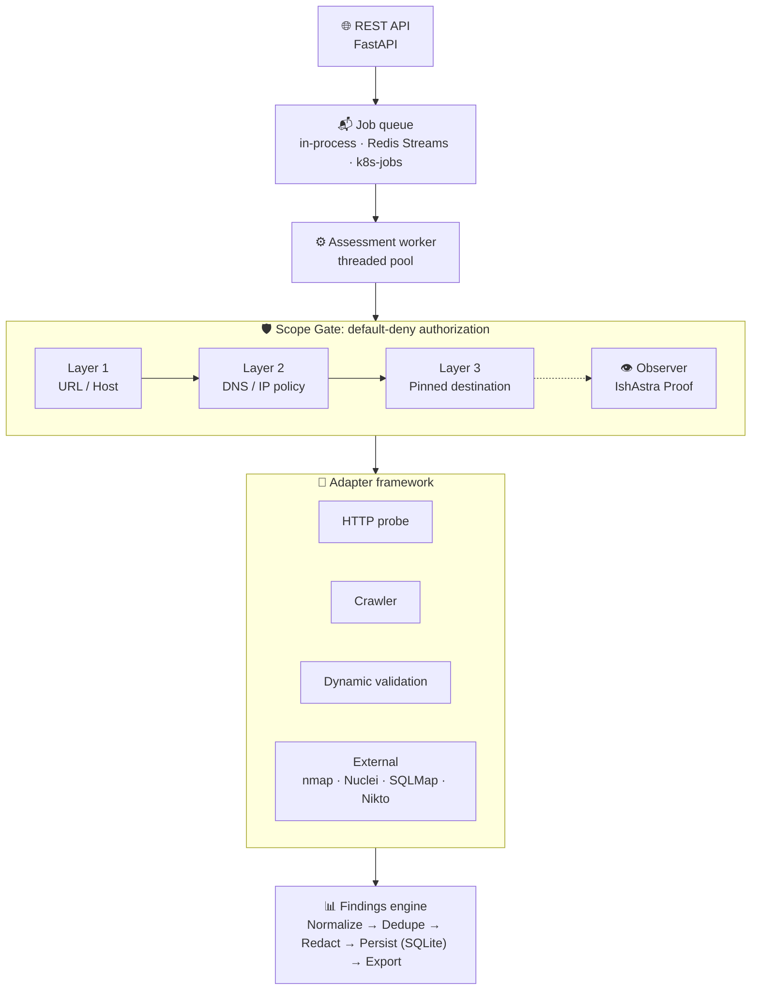
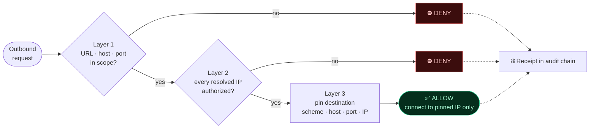
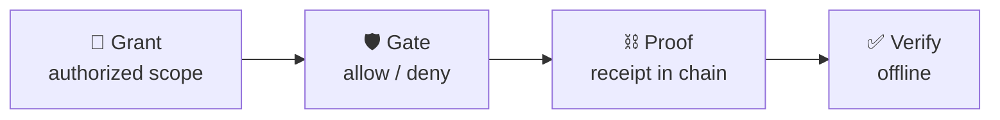
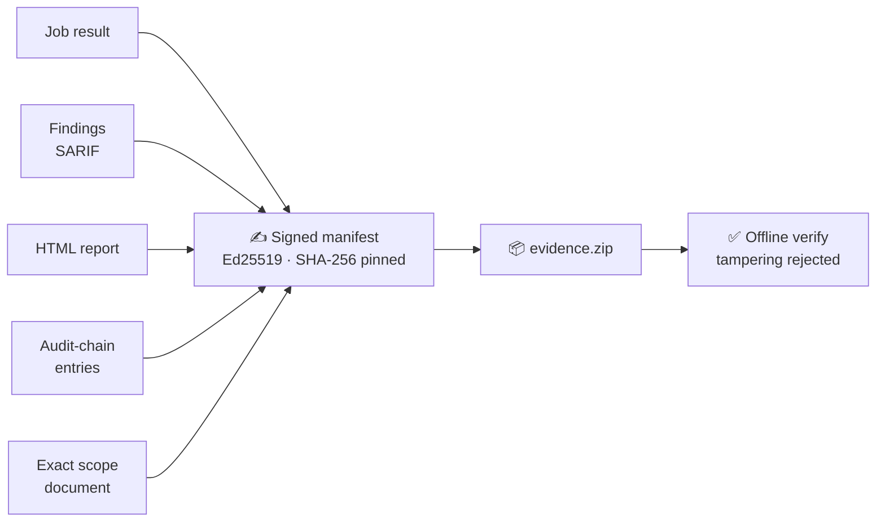

<div align="center">

# <span style="color:#f8fafc; font-size:2.2rem; font-weight:900">IshAstra</span>
# <span style="color:#1e293b; font-size:1.1rem; opacity:0.8">Authorization-First Security Assessment Platform</span>

<span style="display:block; margin:2rem 0; border-top:1px solid #334155; border-bottom:1px solid #334155; padding:1rem 0"></span>



<br>

<sup><span style="color:#64748b">Default-deny authorization that proves you're allowed — before every connection.</span></sup>

<br>

<div align="center" style="gap:1rem;">
  [](LICENSE)
  [](https://github.com/hacker-194/IshAstra/actions)
  [](https://python.org)
  [](https://kubernetes.io)
  [](docs/tla)
  [](#signed-evidence-bundles)
  [](#why-ishastra)
  [](docs/quickstart/production.md)
  [](https://github.com/hacker-194/IshAstra/stargazers)
]
</div>

<p>
  <a href="#why-ishastra" style="color:#1e293b; text-decoration:none; font-weight:600;"><b>Why IshAstra</b></a> &nbsp;•&nbsp; 
  <a href="#architecture" style="color:#1e293b; text-decoration:none; font-weight:600;"><b>Architecture</b></a> &nbsp;•&nbsp;
  <a href="#deployment" style="color:#1e293b; text-decoration:none; font-weight:600;"><b>Deployment</b></a> &nbsp;•&nbsp;
  <a href="#documentation" style="color:#1e293b; text-decoration:none; font-weight:600;"><b>Docs</b></a> &nbsp;•&nbsp;
  <a href="#security" style="color:#1e293b; text-decoration:none; font-weight:600;"><b>Security</b></a> &nbsp;•&nbsp;
  <a href="#contributing" style="color:#1e293b; text-decoration:none; font-weight:600;"><b>Contributing</b></a>
</p>


<table>
  <tr>
    <td align="center" width="25%"><h2>6</h2><sub>TLA+ invariants</sub></td>
    <td align="center" width="25%"><h2>21.4M</h2><sub>states model-checked</sub></td>
    <td align="center" width="25%"><h2>3</h2><sub>default-deny gate layers</sub></td>
    <td align="center" width="25%"><h2>$0</h2><sub>free-tier deployable</sub></td>
  </tr>
</table>

<div align="center" style="margin-top:1.5rem;">
  <sub><span style="color:#64748b">Authorization core: TLA+-model-checked, CI-enforced. Production-ready with single-tenant deployment.</span></sub>
</div>
</div>

## Why IshAstra

<div align="center" style="background:#0f172a; border:1px solid #334155; border-radius:8px; padding:1.5rem; margin:1.5rem 0;">
  <h3 style="color:#f8fafc; margin-top:0;">🛡️ Default-deny authorization</h3>
  <p style="color:#94a3b8; line-height:1.6;">A three-layer Scope Gate validates URL/host, DNS/IP and the pinned destination before any connection is made. If it isn't explicitly authorized, it doesn't happen. <em>No scope, no connection.</em></p>
  <h3 style="color:#f8fafc; margin-top:1.5rem;">🔐 Tenant isolation</h3>
  <p style="color:#94a3b8; line-height:1.6;">API-key tenant isolation, with per-task scope binding through <code>ContextVar</code>s, keeps tenants strictly apart. No cross-tenant leakage.</p>
  <h3 style="color:#f8fafc; margin-top:1.5rem;">⛓️ Cryptographic audit chain</h3>
  <p style="color:#94a3b8; line-height:1.6;">Every gate decision is receipted in a tamper-evident chain that is verifiable offline and compliance-ready. Your evidence, cryptographically signed.</p>
</div>

<div align="center" style="background:#0f172a; border:1px solid #334155; border-radius:8px; padding:1.5rem; margin:1.5rem 0;">
  <h3 style="color:#f8fafc; margin-top:0;">📜 Policy-as-code</h3>
  <p style="color:#94a3b8; line-height:1.6;">Express scope as code with CIDR, ASN and geo rules in a signed scope file. The gate refuses anything else. <em>Code is law.</em></p>
  <h3 style="color:#f8fafc; margin-top:1.5rem;">🌐 DNS-rebinding proof</h3>
  <p style="color:#94a3b8; line-height:1.6;">Hostnames are resolved, every IP is validated, and the connection is pinned to the single approved destination. No DNS rebinding accepted.</p>
  <h3 style="color:#f8fafc; margin-top:1.5rem;">🧰 Real tools</h3>
  <p style="color:#94a3b8; line-height:1.6;">Runs Nuclei, nmap, SQLMap and Nikto through adapters that re-check the gate and emit normalized findings. <em>Real tools, normalized output.</em></p>
</div>

<h3 style="color:#1e293b; margin:2rem 0 1rem 0;">📊 How IshAstra compares</h3>

<table style="width:100%; border-collapse:collapse; font-size:0.85rem;">
  <thead>
    <tr style="background:#0f172a; color:#94a3b8; border-bottom:2px solid #334155;">
      <th style="padding:0.5rem 0.75rem; text-align:left;">Feature</th>
      <th style="padding:0.5rem 0.75rem; text-align:center;">IshAstra</th>
      <th style="padding:0.5rem 0.75rem; text-align:center;">Nuclei</th>
      <th style="padding:0.5rem 0.75rem; text-align:center;">Trivy</th>
      <th style="padding:0.5rem 0.75rem; text-align:center;">OWASP ZAP</th>
      <th style="padding:0.5rem 0.75rem; text-align:center;">OpenVAS</th>
    </tr>
  </thead>
  <tbody>
    <tr style="background:#1e293b; color:#f8fafc;"><td style="padding:0.5rem 0.75rem;">Default-deny authorization</td><td style="padding:0.5rem 0.75rem; text-align:center;" >✅</td><td style="padding:0.5rem 0.75rem; text-align:center;" >❌</td><td style="padding:0.5rem 0.75rem; text-align:center;" >❌</td><td style="padding:0.5rem 0.75rem; text-align:center;" >❌</td><td style="padding:0.5rem 0.75rem; text-align:center;" >❌</td></tr>
    <tr style="background:#1e293b; color:#f8fafc;"><td style="padding:0.5rem 0.75rem;">API-key tenant isolation</td><td style="padding:0.5rem 0.75rem; text-align:center;" >✅</td><td style="padding:0.5rem 0.75rem; text-align:center;" >❌</td><td style="padding:0.5rem 0.75rem; text-align:center;" >❌</td><td style="padding:0.5rem 0.75rem; text-align:center;" >❌</td><td style="padding:0.5rem 0.75rem; text-align:center;" >❌</td></tr>
    <tr style="background:#1e293b; color:#f8fafc;"><td style="padding:0.5rem 0.75rem;">Cryptographic audit chain</td><td style="padding:0.5rem 0.75rem; text-align:center;" >✅</td><td style="padding:0.5rem 0.75rem; text-align:center;" >❌</td><td style="padding:0.5rem 0.75rem; text-align:center;" >❌</td><td style="padding:0.5rem 0.75rem; text-align:center;" >❌</td><td style="padding:0.5rem 0.75rem; text-align:center;" >❌</td></tr>
    <tr style="background:#1e293b; color:#f8fafc;"><td style="padding:0.5rem 0.75rem;">SARIF + compliance reports</td><td style="padding:0.5rem 0.75rem; text-align:center;" >✅</td><td style="padding:0.5rem 0.75rem; text-align:center;" >✅</td><td style="padding:0.5rem 0.75rem; text-align:center;" >✅</td><td style="padding:0.5rem 0.75rem; text-align:center;" >✅</td><td style="padding:0.5rem 0.75rem; text-align:center;" >✅</td></tr>
    <tr style="background:#1e293b; color:#f8fafc;"><td style="padding:0.5rem 0.75rem;">Runs Nuclei / nmap / SQLMap</td><td style="padding:0.5rem 0.75rem; text-align:center;" >✅</td><td style="padding:0.5rem 0.75rem; text-align:center;" >✅</td><td style="padding:0.5rem 0.75rem; text-align:center;" >❌</td><td style="padding:0.5rem 0.75rem; text-align:center;" >❌</td><td style="padding:0.5rem 0.75rem; text-align:center;" >❌</td></tr>
    <tr style="background:#1e293b; color:#f8fafc;"><td style="padding:0.5rem 0.75rem;">Policy-as-code (CIDR+ASN+Geo)</td><td style="padding:0.5rem 0.75rem; text-align:center;" >✅</td><td style="padding:0.5rem 0.75rem; text-align:center;" >❌</td><td style="padding:0.5rem 0.75rem; text-align:center;" >❌</td><td style="padding:0.5rem 0.75rem; text-align:center;" >❌</td><td style="padding:0.5rem 0.75rem; text-align:center;" >❌</td></tr>
    <tr style="background:#1e293b; color:#f8fafc;"><td style="padding:0.5rem 0.75rem;">DNS rebinding protection</td><td style="padding:0.5rem 0.75rem; text-align:center;" >✅</td><td style="padding:0.5rem 0.75rem; text-align:center;" >❌</td><td style="padding:0.5rem 0.75rem; text-align:center;" >❌</td><td style="padding:0.5rem 0.75rem; text-align:center;" >❌</td><td style="padding:0.5rem 0.75rem; text-align:center;" >❌</td></tr>
    <tr style="background:#1e293b; color:#f8fafc;"><td style="padding:0.5rem 0.75rem;">Free-tier deployable</td><td style="padding:0.5rem 0.75rem; text-align:center;" >✅</td><td style="padding:0.5rem 0.75rem; text-align:center;" >✅</td><td style="padding:0.5rem 0.75rem; text-align:center;" >✅</td><td style="padding:0.5rem 0.75rem; text-align:center;" >❌</td><td style="padding:0.5rem 0.75rem; text-align:center;" >❌</td></tr>
    <tr style="background:#1e293b; color:#f8fafc;"><td style="padding:0.5rem 0.75rem;">TLA+ model-checked</td><td style="padding:0.5rem 0.75rem; text-align:center;" >✅</td><td style="padding:0.5rem 0.75rem; text-align:center;" >❌</td><td style="padding:0.5rem 0.75rem; text-align:center;" >❌</td><td style="padding:0.5rem 0.75rem; text-align:center;" >❌</td><td style="padding:0.5rem 0.75rem; text-align:center;" >❌</td></tr>
  </tbody>
</table>

## Try it in one command

> [!NOTE]
> The package is not yet published to PyPI, so install from the repository.

```bash
git clone https://github.com/hacker-194/IshAstra
cd IshAstra
python3 -m venv .venv && . .venv/bin/activate
pip install -c constraints.txt -e .
ishastra demo
```

The demo writes its own <span style="color:#0ea5e9;">Ed25519-signed scope</span> (localhost only), generates an admin key, uses SQLite, and prints the URL plus the key you paste into the top bar. Nothing outside <code>.ishastra-demo/</code> is touched.

### Drop it into CI

The bundled GitHub Action runs a scoped assessment and uploads SARIF:

```yaml
- uses: hacker-194/IshAstra@master  # pin to a commit SHA in production
  with:
    target: https://staging.example.com
    scope-file: scope.json          # signed; the gate refuses anything else
    profile: web-deep
    fail-on-findings: "true"
```

## Architecture



> Every adapter **re-checks the Scope Gate internally**, so a misbehaving adapter can't bypass authorization.

## Core innovations

### 1. Scope Gate: default-deny authorization

<sub><code>src/ishastra/core/scope.py</code></sub>



| Layer | What it checks | Resolves DNS? |
| :---- | :------------- | :-----------: |
| **1 · URL / Host** | Structure, host against include/exclude, port against `allowed_ports` | No |
| **2 · DNS / IP** | Resolves the hostname and validates **every** IP against `authorized_networks`. Special-use addresses (loopback, link-local, private, multicast) are denied unless explicitly authorized | Yes |
| **3 · Pinned destination** | Returns a single `Destination` (scheme, host, port, IP), which prevents DNS rebinding | n/a |

- **`ContextVar` isolation:** per-task scope binding for multi-tenant safety
- **TLA+ verified:** 6 invariants, 21.4M states model-checked

### 2. Break-glass dual approval

<sub><code>src/ishastra/core/scope_breakglass.py</code></sub>

Emergency authorization with a dual-approval workflow. Time-bounded, audited and metrics-instrumented.

### 3. IshAstra Proof: cryptographic audit chain



Every gate decision is receipted. The chain is **tamper-evident**, **verifiable offline** and **compliance-ready**.

### 4. Adapter framework: real tools, normalized output

- **Built-in:** HTTP Probe, Crawler, Dynamic Validation
- **External:** nmap, Nuclei, SQLMap, Nikto
- All adapters re-check the Scope Gate internally

## Signed evidence bundles

`ishastra bundle` packages everything an auditor needs into one zip. The manifest is **Ed25519-signed** and every member is **SHA-256 pinned**. Verification is offline, and any member that was edited, added or removed after signing is rejected.



```bash
# Create
ishastra bundle --job <job-id> --scope scope.json --key scope-signing-key.pem --kid <kid> -o evidence.zip

# Verify (offline)
ishastra bundle --verify evidence.zip --jwks jwks.json
```

## Deployment

<div style="background:#0f172a; border:1px solid #334155; border-radius:8px; padding:1rem; margin:1rem 0;">
  <table style="width:100%; border-collapse:collapse; font-size:0.85rem;">
    <tr style="background:#1e293b; color:#f8fafc; border-bottom:2px solid #334155;"><th style="padding:0.5rem 0.75rem;">Environment</th><th style="padding:0.5rem 0.75rem; text-align:center;">Command</th><th style="padding:0.5rem 0.75rem; text-align:center;">Cost</th></tr>
    <tr style="background:#0f172a; color:#f8fafc;"><td style="padding:0.5rem 0.75rem;">Free tier (Oracle)</td><td style="padding:0.5rem 0.75rem; text-align:center;" >./scripts/bootstrap-free.sh</td><td style="padding:0.5rem 0.75rem; text-align:center;" >$0/month</td></tr>
    <tr style="background:#1e293b; color:#f8fafc;"><td style="padding:0.5rem 0.75rem;">Single-host production</td><td style="padding:0.5rem 0.75rem; text-align:center;" >systemd or Compose, one writer</td><td style="padding:0.5rem 0.75rem; text-align:center;" >Low</td></tr>
    <tr style="background:#0f172a; color:#f8fafc;"><td style="padding:0.5rem 0.75rem;">Local dev</td><td style="padding:0.5rem 0.75rem; text-align:center;" >docker compose up -d</td><td style="padding:0.5rem 0.75rem; text-align:center;" >Free</td></tr>
    <tr style="background:#1e293b; color:#f8fafc;"><td style="padding:0.5rem 0.75rem;">Kind / Minikube</td><td style="padding:0.5rem 0.75rem; text-align:center;" >./scripts/bootstrap-kind.sh</td><td style="padding:0.5rem 0.75rem; text-align:center;" >Free</td></tr>
  </table>
</div>

<details>
<summary><b>☁️ Free tier: $0/month on Oracle Cloud Always Free</b></summary>

<br>

```bash
# One-shot bootstrap on Oracle Cloud Always Free
git clone https://github.com/hacker-194/IshAstra
cd IshAstra
chmod +x scripts/bootstrap-free.sh
./scripts/bootstrap-free.sh
```

**What you get:**

<div style="background:#1e293b; border:1px solid #334155; border-radius:6px; padding:1rem; margin:0.5rem 0;">
  <table style="width:100%; border-collapse:collapse; font-size:0.8rem;">
    <tr style="background:#0f172a; color:#94a3b8; border-bottom:2px solid #334155;"><th style="padding:0.4rem 0.6rem;">Component</th><th style="padding:0.4rem 0.6rem; text-align:center;">Details</th></tr>
    <tr style="background:#1e293b; color:#cfdef3;"><td style="padding:0.4rem 0.6rem;">☸️</td><td style="padding:0.4rem 0.6rem;">k0s cluster: Oracle Always Free Arm (2 OCPU / 12 GB total, halved by Oracle in June 2026). Add a third controller for quorum.</td></tr>
    <tr style="background:#1e293b; color:#cfdef3;"><td style="padding:0.4rem 0.6rem;">🐘</td><td style="padding:0.4rem 0.6rem;">Neon PostgreSQL: Serverless, 0.5 GB free.</td></tr>
    <tr style="background:#1e293b; color:#cfdef3;"><td style="padding:0.4rem 0.6rem;">⚡</td><td style="padding:0.4rem 0.6rem;">Upstash Redis: Serverless, 256 MB free.</td></tr>
    <tr style="background:#1e293b; color:#cfdef3;"><td style="padding:0.4rem 0.6rem;">🌩️</td><td style="padding:0.4rem 0.6rem;">Cloudflare Tunnel: Ingress with zero public IP and DDoS protection.</td></tr>
    <tr style="background:#1e293b; color:#cfdef3;"><td style="padding:0.4rem 0.6rem;">🔒</td><td style="padding:0.4rem 0.6rem;">SealedSecrets: Git-safe secret management.</td></tr>
    <tr style="background:#1e293b; color:#cfdef3;"><td style="padding:0.4rem 0.6rem;">📈</td><td style="padding:0.4rem 0.6rem;">Prometheus + Grafana: Monitoring out of the box.</td></tr>
    <tr style="background:#1e293b; color:#cfdef3;"><td style="padding:0.4rem 0.6rem;">🚪</td><td style="padding:0.4rem 0.6rem;">IshAstra ScopeGate API: Served at <code>https://api.yourdomain.com</code>.</td></tr>
  </table>
</div>

</details>

<details>
<summary><b>🐳 Local development with Docker Compose</b></summary>

<br>

```bash
cp .env.example .env
# Set POSTGRES_PASSWORD, GRAFANA_PASSWORD and KEYCLOAK_ADMIN_PASSWORD in .env
docker compose up -d
# API → http://localhost:8000
# Grafana → http://localhost:3000  (log in with GRAFANA_PASSWORD)
```

</details>

### Data backend and queue modes

<div style="background:#0f172a; border:1px solid #334155; border-radius:8px; padding:1rem; margin:1rem 0;"><table style="width:100%; border-collapse:collapse; font-size:0.85rem;"><tr style="background:#1e293b; color:#f8fafc; border-bottom:2px solid #334155;"><th style="padding:0.5rem 0.75rem;">Component</th><th style="padding:0.5rem 0.75rem; text-align:center;">Default</th><th style="padding:0.5rem 0.75rem; text-align:center;">Alternative</th><th style="padding:0.5rem 0.75rem; text-align:center;">Notes</th></tr><tr style="background:#0f172a; color:#cfdef3;"><td style="padding:0.5rem 0.75rem;">Database</td><td style="padding:0.5rem 0.75rem; text-align:center;" >**SQLite**, the supported single-host pilot backend</td><td style="padding:0.5rem 0.75rem; text-align:center;" >**PostgreSQL** via `ISHASTRA_DB=postgresql://...` and the `postgres` extra</td><td style="padding:0.5rem 0.75rem; text-align:center;" >*Experimental.* Schema, RLS and a single-host worker path are tested, but there is no HA or multi-node failover.</td></tr><tr style="background:#0f172a; color:#cfdef3;"><td style="padding:0.5rem 0.75rem;">Queue</td><td style="padding:0.5rem 0.75rem; text-align:center;" >**<code>in-process</code>**, held in memory (a restart loses queued jobs)</td><td style="padding:0.5rem 0.75rem; text-align:center;" >**<code>redis-streams</code>* via `ISHASTRA_QUEUE_MODE=redis-streams` and `ISHASTRA_REDIS_URL`, for durable work shared by workers</td><td style="padding:0.5rem 0.75rem; text-align:center;" >`k8s-jobs` is experimental. See <a href="ARCHITECTURE.md#deployment-constraints">ARCHITECTURE.md</a>.</td></tr></table></div>

## Extend and integrate

<details>
<summary><b>🔌 Third-party adapters (plugins)</b></summary>

<br>

Adapters plug in without forking the project. Publish one under the <code>ishastra.adapters</code> entry-point group and it becomes available to profiles:

```toml
[project.entry-points."ishastra.adapters"]
my-probe = "my_package.adapters:MyProbe"
```

A plugin can add an adapter id but <strong>cannot replace a built-in one</strong>.

> [!CAUTION]
> Third-party adapters are opt-in. Set <code>ISHASTRA_ALLOW_PLUGINS=1</code> only for packages you trust: plugins run in-process and can open network connections <strong>without the Scope Gate</strong>.

</details>

<details>
<summary><b>🔔 Job notifications (webhooks & Slack)</b></summary>

<br>

Set <code>ISHASTRA_NOTIFY_WEBHOOK_URL</code> to POST a JSON summary (job, target, state, verdict, severity counts) whenever a job finishes. The same body carries Slack <code>text</code> and <code>blocks</code>, so a Slack incoming webhook renders it as a formatted card while other receivers read the structured fields.

- Destinations must be <strong>public https URLs</strong>
- Set <code>ISHASTRA_WEBHOOK_SECRET</code> to add an <code>X-Ishastra-Signature: sha256=…</code> HMAC header so the receiver can verify the payload

</details>

<details>
<summary><b>🔔 Job notifications (webhooks &amp; Slack)</b></summary>

<br>

Set `ISHASTRA_NOTIFY_WEBHOOK_URL` to POST a JSON summary (job, target, state, verdict, severity counts) whenever a job finishes. The same body carries Slack `text` and `blocks`, so a Slack incoming webhook renders it as a formatted card while other receivers read the structured fields.

- Destinations must be **public https URLs**
- Set `ISHASTRA_WEBHOOK_SECRET` to add an `X-Ishastra-Signature: sha256=…` HMAC header so the receiver can verify the payload

</details>

## Documentation

| | Guide | |
| :-: | :---- | :-- |
| 🚀 | [Quick Start](docs/quickstart/overview.md) | Install and run your first assessment |
| 🏗️ | [Architecture](ARCHITECTURE.md) | System design and deployment constraints |
| 🛡️ | [Scope Gate Deep Dive](docs/scope-gate/concepts.md) | How authorization decisions are made |
| 🔌 | [Adapter Development](docs/adapters/custom.md) | Build your own adapter |
| 📦 | [Deployment Guide](DEPLOYMENT.md) | Deploy beyond the demo |
| 🏭 | [Production Deployment & Readiness](docs/quickstart/production.md) | What to know before promising uptime |
| 💸 | [Free-Tier Deployment](docs/deployment/free-tier.md) | The $0/month path |
| 🔑 | [API Reference](docs/api/authentication.md) | Authentication and endpoints |
| 📋 | [Compliance Mapping](docs/compliance/overview.md) | Compliance overview |

## Contributing

Contributions are welcome! See [CONTRIBUTING.md](CONTRIBUTING.md) for:

- 🧑‍💻 Development setup
- 🎨 Code style (`ruff`, `mypy`)
- 🧪 Testing requirements
- 🔀 PR process

<a href="https://github.com/hacker-194/IshAstra/graphs/contributors">
  
</a>

## Security

- 🔒 [Security Policy](SECURITY.md): vulnerability disclosure
- 🔍 [Security Review](docs/security-review.md)
- 📐 [TLA+ Verification](docs/tla)

> [!IMPORTANT]
> IshAstra is built for authorized testing. Only assess systems you own or have explicit permission to test.

## License

Released under the **Apache-2.0** license. See [LICENSE](LICENSE).

## Community

- 💬 **Questions and ideas:** [GitHub Discussions](https://github.com/hacker-194/IshAstra/discussions)
- 🐛 **Bugs and requests:** [GitHub Issues](https://github.com/hacker-194/IshAstra/issues)

<br>

<div align="center">


**Built with ❤️ for the open source security community.**

*Authorization-first. Audit-ready. Free forever.*

<br>

[⭐ Star this repo](https://github.com/hacker-194/IshAstra) &nbsp;·&nbsp; [🐛 Report a bug](https://github.com/hacker-194/IshAstra/issues) &nbsp;·&nbsp; [💬 Join the discussion](https://github.com/hacker-194/IshAstra/discussions)

</div>
