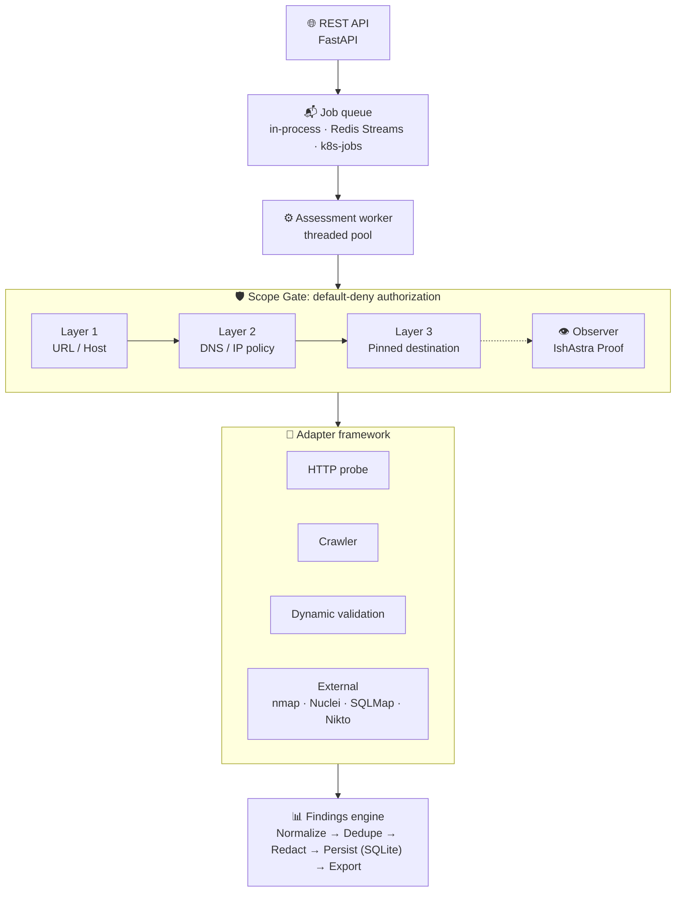
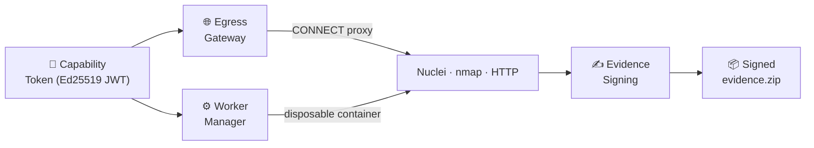
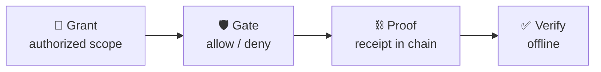
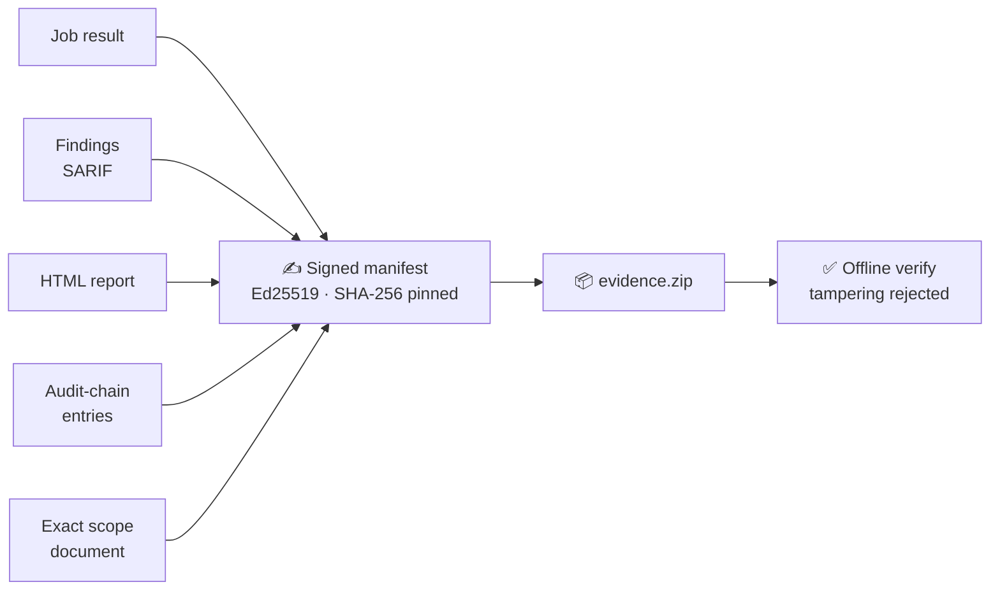

<div align="center">


<br>

### 🛡️ Authorization is enforced before every outbound connection IshAstra makes.

<br>

[](LICENSE)
[](https://github.com/hacker-194/IshAstra/actions)
[](https://python.org)
[](https://kubernetes.io)

[](docs/scope-gate/tla-verification.md)
[](#signed-evidence-bundles)
[](#why-ishastra)
[](docs/quickstart/production.md)
[](https://github.com/hacker-194/IshAstra/stargazers)

<p>
  <a href="#try-it-in-one-command"><b>Quick start</b></a> &nbsp;·&nbsp;
  <a href="#why-ishastra"><b>Why IshAstra</b></a> &nbsp;·&nbsp;
  <a href="#architecture"><b>Architecture</b></a> &nbsp;·&nbsp;
  <a href="#deployment"><b>Deployment</b></a> &nbsp;·&nbsp;
  <a href="#documentation"><b>Docs</b></a> &nbsp;·&nbsp;
  <a href="#security"><b>Security</b></a> &nbsp;·&nbsp;
  <a href="#contributing"><b>Contributing</b></a>
</p>


<table>
  <tr>
    <td align="center" width="25%"><h2>6</h2><sub>TLA+ invariants</sub></td>
    <td align="center" width="25%"><h2>21.4M</h2><sub>states model-checked</sub></td>
    <td align="center" width="25%"><h2>3</h2><sub>default-deny gate layers</sub></td>
    <td align="center" width="25%"><h2>$0</h2><sub>free-tier deployable</sub></td>
  </tr>
</table>

</div>

> [!NOTE]
> **Project status: pilot-ready** (IshAstra 4.0). The authorization core is TLA+-model-checked and CI-enforced; Phase 2 adds capability tokens, egress gateway (CONNECT proxy), hardened worker containers, and signed evidence bundles. Read [Production deployment](docs/quickstart/production.md) before promising uptime, and [SECURITY.md](SECURITY.md) for the honest security posture.

## Why IshAstra

Most scanners ask *"what can I find?"* IshAstra asks **"am I allowed to touch this?"** first, and proves the answer afterwards.

<table>
  <tr>
    <td width="33%" valign="top">
      <h3>🛡️ Default-deny</h3>
      A three-layer Scope Gate validates URL/host, DNS/IP and the pinned destination before any connection is made. If it isn't explicitly authorized, it doesn't happen.
    </td>
    <td width="33%" valign="top">
      <h3>🔐 Tenant isolation</h3>
      API-key tenant isolation, with per-task scope binding through <code>ContextVar</code>s, keeps tenants apart.
    </td>
    <td width="33%" valign="top">
      <h3>⛓️ Audit chain</h3>
      Every gate decision is receipted in a cryptographic chain that is tamper-evident, verifiable offline and compliance-ready.
    </td>
  </tr>
  <tr>
    <td width="33%" valign="top">
      <h3>📜 Policy-as-code</h3>
      Express scope as code with CIDR, ASN and geo rules in a signed scope file. The gate refuses anything else.
    </td>
    <td width="33%" valign="top">
      <h3>🌐 DNS-rebinding proof</h3>
      Hostnames are resolved, every IP is validated, and the connection is pinned to the single approved destination.
    </td>
    <td width="33%" valign="top">
      <h3>🧰 Real tools</h3>
      Runs Nuclei, nmap, SQLMap and Nikto through adapters that re-check the gate and emit normalized findings.
    </td>
  </tr>
</table>

<details>
<summary><b>📊 How IshAstra compares</b></summary>

<br>

| Feature                           | **IshAstra** | Nuclei | Trivy | OWASP ZAP | OpenVAS |
| --------------------------------- | :----------: | :----: | :---: | :-------: | :-----: |
| **Default-deny authorization**    |      ✅      |   ❌   |  ❌   |    ❌     |   ❌    |
| **API-key tenant isolation**      |      ✅      |   ❌   |  ❌   |    ❌     |   ❌    |
| **Cryptographic audit chain**     |      ✅      |   ❌   |  ❌   |    ❌     |   ❌    |
| **SARIF + compliance reports**    |      ✅      |   ✅   |  ✅   |    ✅     |   ✅    |
| **Runs Nuclei / nmap / SQLMap**   |      ✅      |   ✅   |  ❌   |    ❌     |   ❌    |
| **Policy-as-code (CIDR+ASN+Geo)** |      ✅      |   ❌   |  ❌   |    ❌     |   ❌    |
| **DNS rebinding protection**      |      ✅      |   ❌   |  ❌   |    ❌     |   ❌    |
| **Free-tier deployable**          |      ✅      |   ✅   |  ✅   |    ❌     |   ❌    |
| **TLA+ model-checked**            |      ✅      |   ❌   |  ❌   |    ❌     |   ❌    |

</details>

## Try it in one command

> [!NOTE]
> The package is not yet published to PyPI, so install from the repository.

```bash
git clone https://github.com/hacker-194/IshAstra.git
cd IshAstra
python3 -m venv .venv && . .venv/bin/activate
pip install -c constraints.txt -e .
ishastra demo
```

The demo writes its own **Ed25519-signed scope** (localhost only), generates an admin key, uses SQLite, and prints the URL plus the key you paste into the top bar. Nothing outside `.ishastra-demo/` is touched.

### Drop it into CI

The bundled GitHub Action runs a scoped assessment and uploads SARIF:

```yaml
- uses: hacker-194/IshAstra@main  # pin to a commit SHA in production
  with:
    target: https://staging.example.com
    scope-file: scope.json          # signed; the gate refuses anything else
    profile: web-deep
    fail-on-findings: "true"
```

## Architecture



> Every adapter **re-checks the Scope Gate internally**, so a misbehaving adapter can't bypass authorization.

## Phase 2: Security spine (pilot-ready)

| Component | What it does | Key property |
| :-------- | :----------- | :----------- |
| **Capability tokens** | Ed25519-signed JWTs (TTL ≤ 900 s) carrying tenant, engagement, targets, pinned IPs, allowed ports/protocols/tools, budget | Unforgeable; verifiable offline; revocable by token/engagement/tenant |
| **Egress gateway** | CONNECT proxy that enforces capability tokens on every outbound TCP connection | Default-deny; allow/deny receipts in audit chain; Nmap/Nuclei routed through proxy |
| **Worker manager** | Disposable containers with `--read-only`, `--cap-drop ALL`, `--security-opt no-new-privileges:true`, non-root user | No host access; per-task capability injection; automatic cleanup |
| **Evidence signing** | Canonical JSON + Ed25519 manifest; SHA-256 pinned members | Tamper-evident; offline verification; compliance-ready |



## Core innovations

### 1. Scope Gate: default-deny authorization

<sub><code>src/ishastra/core/scope.py</code></sub>


| Layer | What it checks | Resolves DNS? |
| :---- | :------------- | :-----------: |
| **1 · URL / Host** | Structure, host against include/exclude, port against `allowed_ports` | No |
| **2 · DNS / IP** | Resolves the hostname and validates **every** IP against `authorized_networks`. Special-use addresses (loopback, link-local, private, multicast) are denied unless explicitly authorized | Yes |
| **3 · Pinned destination** | Returns a single `Destination` (scheme, host, port, IP), which prevents DNS rebinding | n/a |

- **`ContextVar` isolation:** per-task scope binding for multi-tenant safety
- **TLA+ verified:** 6 invariants, 21.4M states model-checked

### 2. Break-glass dual approval

<sub><code>src/ishastra/core/scope_breakglass.py</code></sub>

Emergency authorization with a dual-approval workflow. Time-bounded, audited and metrics-instrumented.

### 3. IshAstra Proof: cryptographic audit chain



Every gate decision is receipted. The chain is **tamper-evident**, **verifiable offline** and **compliance-ready**.

### 4. Adapter framework: real tools, normalized output

- **Built-in:** HTTP Probe, Crawler, Dynamic Validation
- **External:** nmap, Nuclei, SQLMap, Nikto
- All adapters re-check the Scope Gate internally
- **Enforcement modes:** `proxy` (routed through CONNECT gateway, e.g., Nuclei), `firewall` (host nftables), `none` (direct execution with in-process gate re-check)

| Adapter | Enforcement | Notes |
| :------ | :---------- | :---- |
| HTTP Probe | `proxy` | All requests through gateway |
| Nuclei | `proxy` | Runs via `--proxy` flag |
| nmap | `none` | Direct execution; gateway logic tested but path not proxied |
| SQLMap | `none` | Direct execution; in-process gate re-check |
| Nikto | `none` | Direct execution; in-process gate re-check |

## Signed evidence bundles

`ishastra bundle` packages everything an auditor needs into one zip. The manifest is **Ed25519-signed** and every member is **SHA-256 pinned**. Verification is offline, and any member that was edited, added or removed after signing is rejected.



```bash
# Create
ishastra bundle --job <job-id> --scope scope.json --key scope-signing-key.pem --kid <kid> -o evidence.zip

# Verify (offline)
ishastra bundle --verify evidence.zip --jwks jwks.json
```

## Deployment

| Environment                | Command                                                        |   Cost   |
| :------------------------- | :------------------------------------------------------------- | :------: |
| **Free tier (Oracle)**     | `./scripts/bootstrap-free.sh`                                  | $0/month |
| **Single-host production** | systemd or Compose, one writer                                 |   Low    |
| **Local dev**              | `docker compose up -d` (after setting the required passwords)  |   Free   |
| **Kubernetes (Helm)**      | `helm install ishastra ./deploy/helm/ishastra -n ishastra --create-namespace` | Varies |

<details>
<summary><b>☁️ Free tier: $0/month on Oracle Cloud Always Free</b></summary>

<br>

```bash
# One-shot bootstrap on Oracle Cloud Always Free
git clone https://github.com/hacker-194/IshAstra.git
cd IshAstra
chmod +x scripts/bootstrap-free.sh
./scripts/bootstrap-free.sh
```

**What you get:**

| | Component | Details |
| :-: | :-------- | :------ |
| ☸️ | **k0s cluster** | Oracle Always Free Arm (2 OCPU / 12 GB total, halved by Oracle in June 2026). Add a third controller for quorum |
| 🐘 | **Neon PostgreSQL** | Serverless, 0.5 GB free |
| ⚡ | **Upstash Redis** | Serverless, 256 MB free |
| 🌩️ | **Cloudflare Tunnel** | Ingress with zero public IP and DDoS protection |
| 🔒 | **SealedSecrets** | Git-safe secret management |
| 📈 | **Prometheus + Grafana** | Monitoring out of the box |
| 🚪 | **IshAstra ScopeGate API** | Served at `https://api.yourdomain.com` |

</details>

<details>
<summary><b>🐳 Local development with Docker Compose</b></summary>

<br>

```bash
cp .env.example .env
# Set POSTGRES_PASSWORD and GRAFANA_PASSWORD in .env
docker compose up -d
# API     → http://localhost:8000
# Grafana → http://localhost:3000  (log in with GRAFANA_PASSWORD)
```

</details>

### Data backend and queue modes

| Component | Default | Alternative | Notes |
| :-------- | :------ | :---------- | :---- |
| **Database** | **SQLite**, the supported single-host pilot backend | **PostgreSQL** via `ISHASTRA_DB=postgresql://...` and the `postgres` extra | *Experimental.* Schema, RLS and a single-host worker path are tested, but there is no HA or multi-node failover |
| **Queue** | **`in-process`**, held in memory (a restart loses queued jobs) | **`redis-streams`** via `ISHASTRA_QUEUE_MODE=redis-streams` and `ISHASTRA_REDIS_URL`, for durable work shared by workers | `k8s-jobs` is experimental. See [ARCHITECTURE.md](ARCHITECTURE.md#deployment-constraints) |

## Extend and integrate

<details>
<summary><b>🔌 Third-party adapters (plugins)</b></summary>

<br>

Adapters plug in without forking the project. Publish one under the `ishastra.adapters` entry-point group and it becomes available to profiles:

```toml
[project.entry-points."ishastra.adapters"]
my-probe = "my_package.adapters:MyProbe"
```

A plugin can add an adapter id but **cannot replace a built-in one**.

> [!CAUTION]
> Third-party adapters are opt-in. Set `ISHASTRA_ALLOW_PLUGINS=1` only for packages you trust: plugins run in-process and can open network connections **without the Scope Gate**.

</details>

<details>
<summary><b>🔔 Job notifications (webhooks &amp; Slack)</b></summary>

<br>

Set `ISHASTRA_NOTIFY_WEBHOOK_URL` to POST a JSON summary (job, target, state, verdict, severity counts) whenever a job finishes. The same body carries Slack `text` and `blocks`, so a Slack incoming webhook renders it as a formatted card while other receivers read the structured fields.

- Destinations must be **public https URLs**
- Set `ISHASTRA_WEBHOOK_SECRET` to add an `X-Ishastra-Signature: sha256=…` HMAC header so the receiver can verify the payload

</details>

## Documentation

| | Guide | |
| :-: | :---- | :-- |
| 🚀 | [Quick Start](docs/quickstart/overview.md) | Install and run your first assessment |
| 🏗️ | [Architecture](ARCHITECTURE.md) | System design and deployment constraints |
| 🛡️ | [Scope Gate Deep Dive](docs/scope-gate/concepts.md) | How authorization decisions are made |
| 🔌 | [Adapter Development](docs/adapters/custom.md) | Build your own adapter |
| 📦 | [Deployment Guide](DEPLOYMENT.md) | Deploy beyond the demo |
| 🏭 | [Production Deployment & Readiness](docs/quickstart/production.md) | What to know before promising uptime |
| 💸 | [Free-Tier Deployment](docs/deployment/free-tier.md) | The $0/month path |
| 🔑 | [API Reference](docs/api/authentication.md) | Authentication and endpoints |
| 📋 | [Compliance Mapping](docs/compliance/overview.md) | Compliance overview |

## Contributing

Contributions are welcome! See [CONTRIBUTING.md](CONTRIBUTING.md) for:

- 🧑‍💻 Development setup
- 🎨 Code style (`ruff`, `mypy`)
- 🧪 Testing requirements
- 🔀 PR process

<a href="https://github.com/hacker-194/IshAstra/graphs/contributors">
  
</a>

## Security

- 🔒 [Security Policy](SECURITY.md): vulnerability disclosure
- 🔍 [Security Review](docs/security-review.md)
- 📐 [TLA+ Verification](docs/scope-gate/tla-verification.md)

> [!IMPORTANT]
> IshAstra is built for authorized testing. Only assess systems you own or have explicit permission to test.

## License

Released under the **Apache-2.0** license. See [LICENSE](LICENSE).

## Community

- 💬 **Questions and ideas:** [GitHub Discussions](https://github.com/hacker-194/IshAstra/discussions)
- 🐛 **Bugs and requests:** [GitHub Issues](https://github.com/hacker-194/IshAstra/issues)

<br>

<div align="center">


*Authorization-first. Audit-ready. Free forever.*

<br>

[⭐ Star this repo](https://github.com/hacker-194/IshAstra) &nbsp;·&nbsp; [🐛 Report a bug](https://github.com/hacker-194/IshAstra/issues) &nbsp;·&nbsp; [💬 Join the discussion](https://github.com/hacker-194/IshAstra/discussions)

</div>
