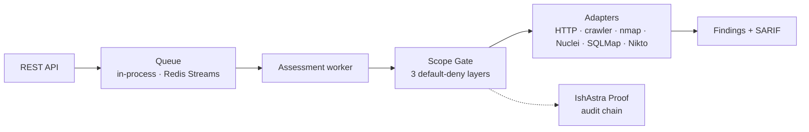

# IshAstra Documentation

**Authorization-first security assessment.** IshAstra asks *"am I allowed to touch this?"* before it scans, then leaves a verifiable receipt of every decision.

## Quick start

```bash
git clone https://github.com/hacker-194/IshAstra.git
cd IshAstra
python3 -m venv .venv && . .venv/bin/activate
pip install -c constraints.txt -e .
ishastra demo
```

`ishastra demo` starts a self-contained instance at `http://127.0.0.1:8000` with a generated admin key, an Ed25519-signed localhost-only scope, and a SQLite database. It prints the API key to paste into the UI; nothing outside `./.ishastra-demo/` is modified.

## Run your first assessment

```bash
ishastra scope-wizard --output scope.json
ishastra assess run \
  --target https://app.example.com/ \
  --scope scope.json \
  --profile web \
  --output result.sarif
```

The scope document is the authorization record: it lists the hosts, networks, ports and expiry the assessment may touch. The gate denies everything else before a connection is opened.

## What IshAstra provides

- **Scope Gate** — three default-deny layers: URL/host/port, every resolved IP against `authorized_networks`, then a pinned destination to prevent DNS rebinding.
- **Adapters** — HTTP probe, crawler, dynamic validation, and wrapped Nuclei, nmap, SQLMap and Nikto. Every adapter re-checks the gate.
- **IshAstra Proof** — Ed25519-signed grants and a hash-chained receipt for every allow/deny decision.
- **Evidence bundles** — `ishastra bundle` packages the job, findings, report, audit entries and exact scope into one signed, SHA-256-pinned zip that verifies offline.
- **Multi-tenancy** — API-key tenant isolation, per-tenant keys, and optional PostgreSQL row-level security.

## Architecture



- **Database:** SQLite is the supported single-host default. PostgreSQL is available and tested single-host, but remains experimental (no HA or multi-node failover).
- **Queue:** in-process is the default (a restart loses queued jobs). Redis Streams is the durable option for multiple workers.
- **Formal verification:** 6 TLA+ invariants across 21,458,641 states.

## Deployment

| Target | Start here |
| :----- | :--------- |
| Local evaluation | `ishastra demo` |
| Full local stack | `docker compose up -d` (set `POSTGRES_PASSWORD` and `GRAFANA_PASSWORD`) |
| Single-host production | [Production deployment](quickstart/production.md) |
| Kubernetes / Helm | [Helm guide](deployment/helm.md) |
| Free tier | [Free-tier deployment](deployment/free-tier.md) |

## Documentation map

| Section | Contents |
| :------ | :------- |
| Quick Start | Install, scope, assess, serve |
| Architecture | Components, Scope Gate, adapters, jobs, proof chain |
| Scope Gate | Concepts, configuration, policies, break-glass, TLA+ |
| Deployment | Kubernetes, Helm, Compose, monitoring, runbooks |
| API Reference | Authentication, assessments, findings, scope, webhooks |
| Compliance | NIST 800-53, ISO 27001, SOC 2, PCI DSS mappings |

## Project status

IshAstra 4.0 is pilot-ready: the authorization core is model-checked, the test suite and security scans run in CI, and the documented limits are explicit. Read [Production deployment](quickstart/production.md) before promising uptime, and [SECURITY.md](https://github.com/hacker-194/IshAstra/blob/main/SECURITY.md) for the threat model.

## Community and license

- Questions and ideas: [GitHub Discussions](https://github.com/hacker-194/IshAstra/discussions)
- Bugs and feature requests: [GitHub Issues](https://github.com/hacker-194/IshAstra/issues)
- License: [Apache-2.0](license.md)
